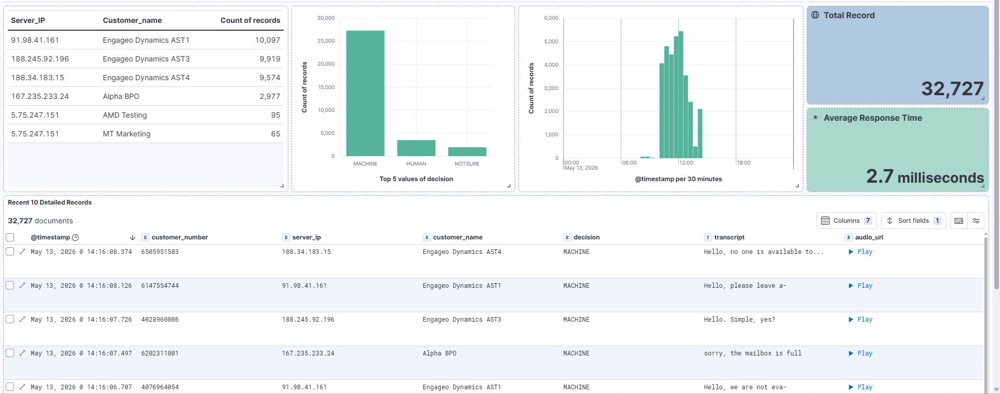

# AMD - Answering Machine Detection

Production AMD system for outbound dialers. Uses **Whisper STT** + **Silero VAD** + **TF-IDF ML classifier** to detect human vs machine in under 2.5 seconds. Integrates with **Asterisk/VICIdial** via EAGI, logs to **Elasticsearch**, stores audio on **Hetzner SFTP**.

# Performance Monitoring & Analytics

## Real-Time AMD (Answering Machine Detection) Dashboard

Access the live monitoring interface for system accuracy and classification metrics:
[**Launch Kibana Dashboard**]((http://k.softotele.com/app/r/s/ZOKWo)


## Architecture

```
Asterisk EAGI (amd.py)
    │  PCM16 @ 8kHz
    ▼
ws_server.py ── WebSocket ──▶  Whisper STT + Silero VAD + ML Classifier
                                       │
                              ┌────────┴────────┐
                              ▼                  ▼
                       elastic_logger       audio_logger
                      (Elasticsearch)    (SFTP Storage Box)
```

**9-step classification pipeline:**

1. Empty/hallucination → MACHINE
2. All-numbers → MACHINE (IVR)
3. Standalone number → MACHINE
4. Greeting-only + P2A/confidence → HUMAN
5. Greeting + machine keywords → MACHINE
6. Greeting + human keywords → HUMAN
7. Full-text machine keywords → MACHINE
8. Full-text human keywords → HUMAN
9. ML classifier (≥0.70 conf) or default → NOTSURE

## Project Structure

```
/amd-server/
├── .env                          # Environment variables (secrets)
├── config.py                     # Central config loader (reads .env)
├── requirements.txt              # Python dependencies
├── run.sh                        # Startup orchestrator (sources setenv.sh)
├── amd.py                        # Asterisk EAGI script
│
├── server/                       #  All server‑side Model Web Socket
│   ├── ws_server.py              # FastAPI WebSocket Elastic DataStorage
│   ├── elastic_logger.py         # Elasticsearch Audio Storage 
│   ├── audio_logger.py           # SFTP audio Dashboard
│   ├── elastic_dashboard.py      # Streamlit 
Setup Guide For ws_server.py(Run Before Running Web Socket) 
│   └── setenv.sh                 # Loads .env and exports variables
│
├── client/
│   └── ws_client.py              # Test client – 
ML Calssifers/ Fine Tune  
│
├── scripts/
│   ├── finetune_whisper_small.py
│   ├── train_text_cls.py
│   └── bulk_ws_eval.py
│
└── models/
    ├── text_cls_amd_v2.joblib    # ML classifier (required)
    └── whisper-ct2/              # CTranslate2 Whisper model
```

## Documentation Index

- `docs/000-system-overview.md` — system purpose and scope
- `docs/001-architecture.md` — runtime architecture and data flow
- `docs/004-api-and-interface-reference.md` — websocket, REST, and AGI interfaces
- `docs/009-security-analysis.md` — verified security findings and hardening steps
- `docs/012-deployment-and-operations.md` — runbook and operational notes
- `docs/014-known-issues-and-tech-debt.md` — current risks and debt inventory

---

## Quick Start (Server: 142.93.152.160)

### Step 1 — SSH & Setup

```bash
ssh root@142.93.152.160
cd /root/amd-server
```

### Step 2 — Virtual Environment

```bash
python3 -m venv venv
source venv/bin/activate
# You should see: (venv) root@AMD-Detection:~/amd-server#

pip install --upgrade pip
pip install -r requirements.txt
```

If anything is missing:

```bash
pip install faster-whisper soxr torch numpy joblib fastapi uvicorn \
            websocket-client paramiko elasticsearch python-dotenv pydub
```

### Step 3 — Verify Models

```bash
ls models/
# Must see: text_cls_amd_v2.joblib
```

### Step 4 — Configure

Edit `.env` with your settings, or set manually:

```bash
# GPU server
export WHISPER_MODEL_DIR=small.en
export DEVICE=cuda
export COMPUTE_TYPE=float16
export CLASSIFIER_PATH=models/text_cls_amd_v2.joblib

# CPU-only server (no GPU)
export DEVICE=cpu
export COMPUTE_TYPE=int8
```

Or load everything from `.env`:

```bash
export $(grep -v '^#' .env | xargs)
```

### Step 5 — Start Server

```bash
cd server
uvicorn ws_server:app --host 0.0.0.0 --port 8989
```

Expected output:

```
AMD Whisper WS Server - Production v9.0
[INIT] Elasticsearch Logging: ENABLED
[INIT] Audio Storage: ENABLED (MP3, filter=all)
Whisper model loaded
Silero VAD ready
Ready for connections
```

### Step 6 — Verify

```bash
curl http://localhost:8989/health
curl http://localhost:8989/status
curl http://localhost:8989/elastic-status
curl http://localhost:8989/audio-status
```

---

## Process Management

The repository ships with `run.sh` for foreground/background control and health checks:

```bash
chmod +x run.sh
./run.sh              # foreground
./run.sh --bg         # background
./run.sh --status     # health check
./run.sh --stop       # stop server
./run.sh --logs       # tail logs
```

> If you want `systemd`, create and maintain the unit file in your deployment environment. A committed `amd-server.service` file is not present in this repository snapshot.

---

## Analytics Dashboard

```bash
source venv/bin/activate
export $(grep -v '^#' .env | xargs)
streamlit run elastic_dashboard.py --server.port 8501
```

Access the dashboard on your configured host and port, for example `http://<server>:8501`.

> Use organization-managed Kibana or dashboard credentials from secure ops documentation or environment management, not from the README.

---

## Audio Storage (SFTP)

When `AUDIO_SAVE_ENABLED=true`, audio files are uploaded by `audio_logger.py` and typically named like `{VID}_{YYYYMMDD_HHMMSS}.mp3`.

Configure storage access through `.env`:

```bash
STORAGE_SERVER=<your-storage-host>
STORAGE_USER=<your-storage-user>
STORAGE_PASSWORD=<secret>
STORAGE_PATH=/home/audio_storage/
AUDIO_FORMAT=mp3
AUDIO_SAVE_FILTER=all
```

Test connectivity with your own managed credentials:

```bash
ssh -p 23 <user>@<storage-host>
```

---

## Asterisk / VICIdial Integration

### Install EAGI Script

```bash
cp amd.py /var/lib/asterisk/agi-bin/amd.py
chmod +x /var/lib/asterisk/agi-bin/amd.py
export AMD_WS_URL=ws://127.0.0.1:8989/ws/amd
```

### Dialplan

```
; VICIDIAL auto dialer transfer script AMD (load-balanced)
exten => 8370,1,AGI(agi://127.0.0.1:4577/call_log)
exten => 8370,n,Playback(sip-silence)
exten => 8370,n,EAGI(/var/lib/asterisk/agi-bin/amd1.py)
exten => 8370,n,GotoIf($["${AMDCAUSE}" = "CONNECTION_ERROR" | "${AMDCAUSE}" = "INTERR"]?amd_fallback:continue)
exten => 8370,n(amd_fallback),AMD(2000,2000,1000,5000,120,50,4,256)
exten => 8370,n(continue),AGI(VD_amd.agi,${EXTEN})
exten => 8370,n,AGI(agi-VDAD_ALL_outbound.agi,NORMAL-----LB-----${CONNECTEDLINE(name)})
exten => 8370,n,Hangup()
```

### Channel Variables Set by amd.py

| Variable | Values | Description |
|---|---|---|
| `AMDSTATUS` | `HUMAN` / `MACHINE` / `NOTSURE`| 
| `AMDCAUSE` | 0.00–1.00 | Confidence score |

---

## Testing

### Stream a WAV file

```bash
python client/ws_client.py --url ws://localhost:8989/ws/amd --wav test.wav
```

### Batch evaluate

```bash
python scripts/bulk_ws_eval.py \
  --audio_dir /path/to/audio/ \
  --csv_out results.csv \
  --url ws://127.0.0.1:8989/ws/amd \
  --concurrency 4
```

---

## Training

### Fine-tune Whisper

```bash
python scripts/finetune_whisper_small.py \
  --csv data.csv --out_dir models/whisper-small-finetuned --batch 4

# Export to CTranslate2
ct2-transformers-converter \
  --model models/whisper-small-finetuned \
  --output_dir models/whisper-ct2 \
  --quantization float16
```

### Train Text Classifier

```bash
python scripts/train_text_cls.py \
  --csv labels.csv --out models/text_cls_amd_v2.joblib
```

CSV format: `text,label` where label is `human` or `machine`.

---

## Troubleshooting

| Problem | Fix |
|---|---|
| `libcudnn_ops.so.9` not found | `apt install libcudnn9-cuda-12` |
| `paramiko` missing | `pip install paramiko` |
| `soxr` missing | `pip install soxr` |
| SFTP auth failed | Check `STORAGE_PASSWORD` in `.env` — has special chars |
| Elasticsearch refused | Verify `ELASTICSEARCH_URL` and `ELASTIC_API_KEY` |
| Model not found | Ensure `models/text_cls_amd_v2.joblib` exists |
| `client/ws_client.py` cannot connect locally | Pass `--url ws://localhost:8989/ws/amd` because the sample client defaults to port `8080` |
| ML classifier appears inactive | Check startup logs for feature-mismatch warnings; the current bundle can fall back to keyword-only mode |

---

## Security

- `.env` is in `.gitignore` — never commit credentials
- Run behind nginx/caddy with TLS for public deployments
- Restrict port 8989 to Asterisk server IPs via firewall
- Rotate Elasticsearch API key and SFTP password periodically